<div align="center">

# AstroMeow

### Train like an astronaut with Astro the Cat

A free browser game that teaches kids 7-12 how astronauts live, work and survive in space.
Built in 24 hours for **NASA Space Apps Challenge 2026** (Stalowa Wola),<br>challenge #3: *Junior Astronaut Mission Trainer*.


</div>

---

## See it in action

<table width="100%">
<tr>
<th width="33%">Quiz missions</th>
<th width="33%">Mini-games</th>
<th width="33%">Base builder</th>
</tr>
<tr>
<td align="center">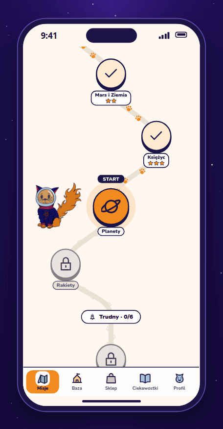</td>
<td align="center">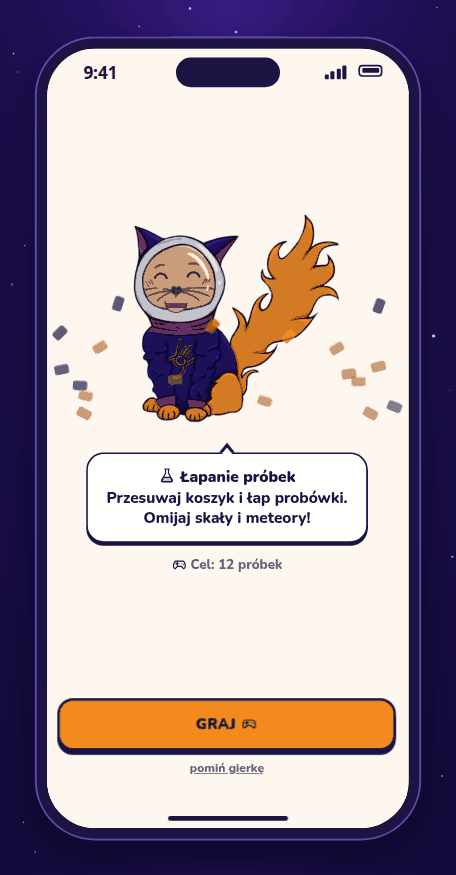</td>
<td align="center">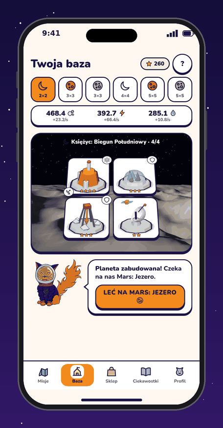</td>
</tr>
<tr>
<td align="center">Short lessons and questions along a mission trail from Earth to the Moon and Mars</td>
<td align="center">Five canvas games: flight, shooter, supply catch, landing, rocket packing</td>
<td align="center">3D buildings, resource economy, safety decisions that cost or reward you</td>
</tr>
</table>

## The pitch

Space education for kids is mostly reading. AstroMeow turns it into a loop kids actually repeat:

> **learn a lesson → pass a quiz → play an arcade mini-game → spend what you earned on a base on the Moon, Mars and Mercury**

Every choice about oxygen, energy, water and safety has a visible result in your own growing base, so the knowledge sticks because it *does* something.

No account. No tracking of personal data. Works on a phone or a laptop, and ships as **one self-contained HTML file**.


## Features

- **Mission trail:** lessons and quizzes with hearts and a golden life
- **5 canvas mini-games:** flight, shooter, supply catch, lander, rocket packing
- **Base builder** on the Moon, Mars and Mercury with Oxygen, Energy and Water; a safety question on each entry (right +20%, wrong -10%)
- **3D buildings** rendered with three.js to sprites in one shared WebGL context, icon fallback without WebGL
- **Live NASA data:** DONKI space weather and APOD, fetched server-side so players never hit the API limit
- **Facts** about NASA, ESA, POLSA and the Polish-led IGNIS mission
- **Extras:** 10 skins for Astro, Web Audio sounds, nicknames with a PL/EN profanity filter, per-game leaderboards
- **Content in JSON:** adding a stage needs no code

## Meet Astro's skins
<br>
<p align="center">
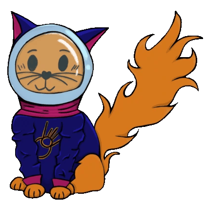 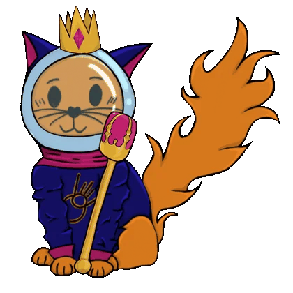 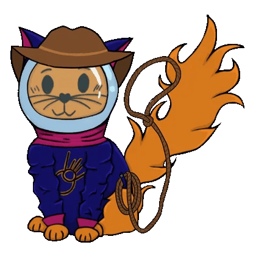 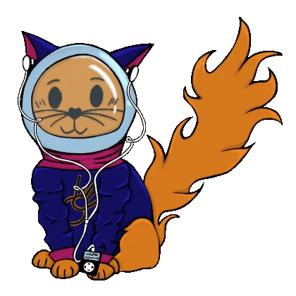 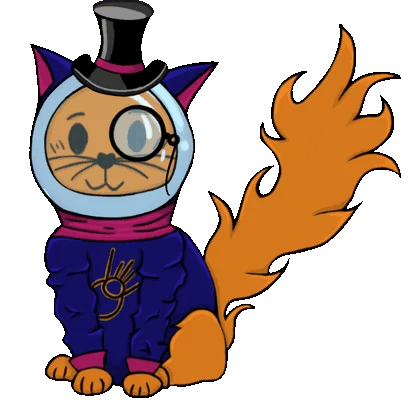<br>
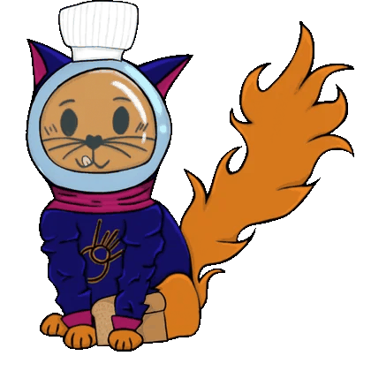 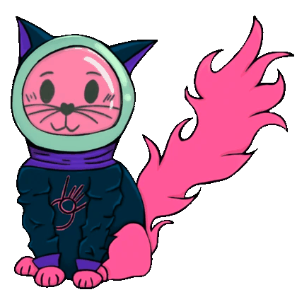 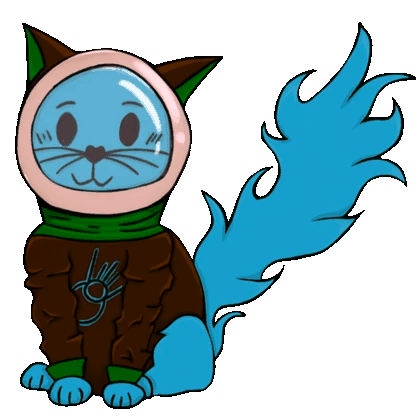 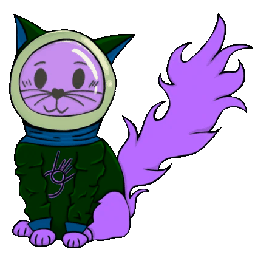 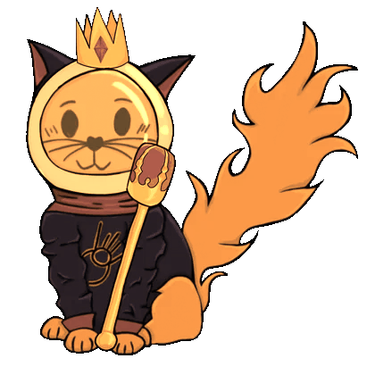
</p>


## Run it

```bash
git clone git@github.com:bartekdylewski/astromeow.git
cd astromeow
bash run.sh                 # build + server + SQLite, open http://127.0.0.1:8085
```

Needs only `python3`. For live NASA data pass a free key from [api.nasa.gov](https://api.nasa.gov): `NASA_API_KEY=... bash run.sh` (falls back to `DEMO_KEY`).

Tests:

```bash
bash counter/counter.sh test
python3 -m unittest tests/test_nasa.py tests/test_players.py
```

Developer notes (Polish): [docs/DEVELOPMENT.md](docs/DEVELOPMENT.md) · adding a stage: [docs/JAK-DODAC-ETAP.md](docs/JAK-DODAC-ETAP.md) · deploy: [docs/deploy.md](docs/deploy.md)

## Roadmap

- English version of the game (UI is Polish today)
- Classroom mode for teachers with class leaderboards
- More missions and planets

## Data and credits

- NASA Open APIs: DONKI (space weather), APOD. [api.nasa.gov](https://api.nasa.gov)
- Mission facts from public NASA, ESA and POLSA pages. Logo sources and licences: [assets/facts/SOURCES.md](assets/facts/SOURCES.md)
- three.js (MIT)

AstroMeow is an independent hackathon project and is not affiliated with or endorsed by NASA, ESA or POLSA.

---

<div align="center">
Made in Stalowa Wola · NASA Space Apps Challenge 2026<br>
<a href="https://github.com/bartekdylewski">@bartekdylewski</a> <a href="https://github.com/Hurtekk">@Hurtekk</a> <a href="juls-s05">@Juls-s05</a>
</div>
